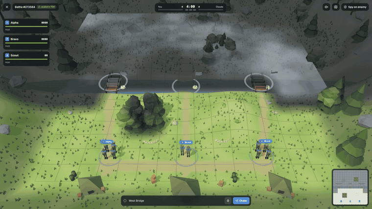
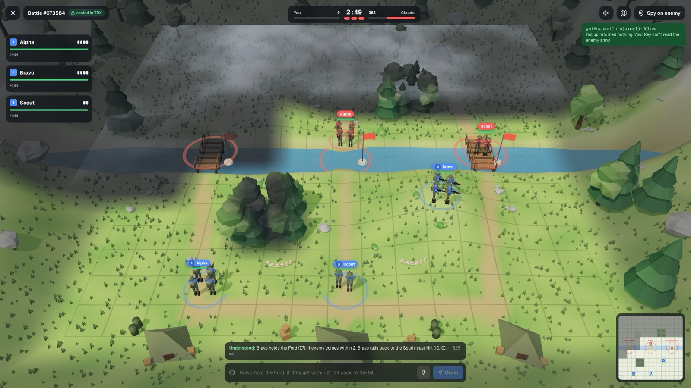
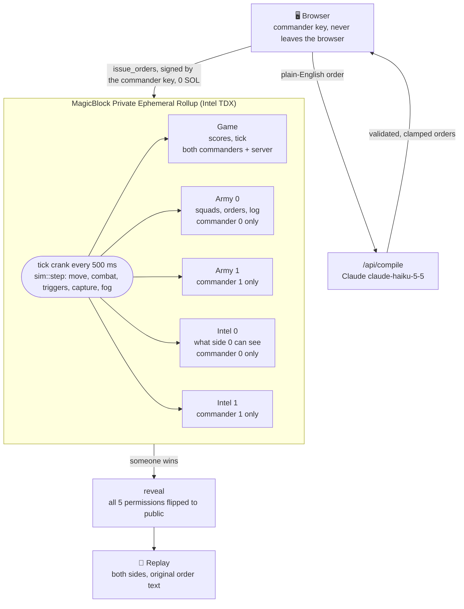
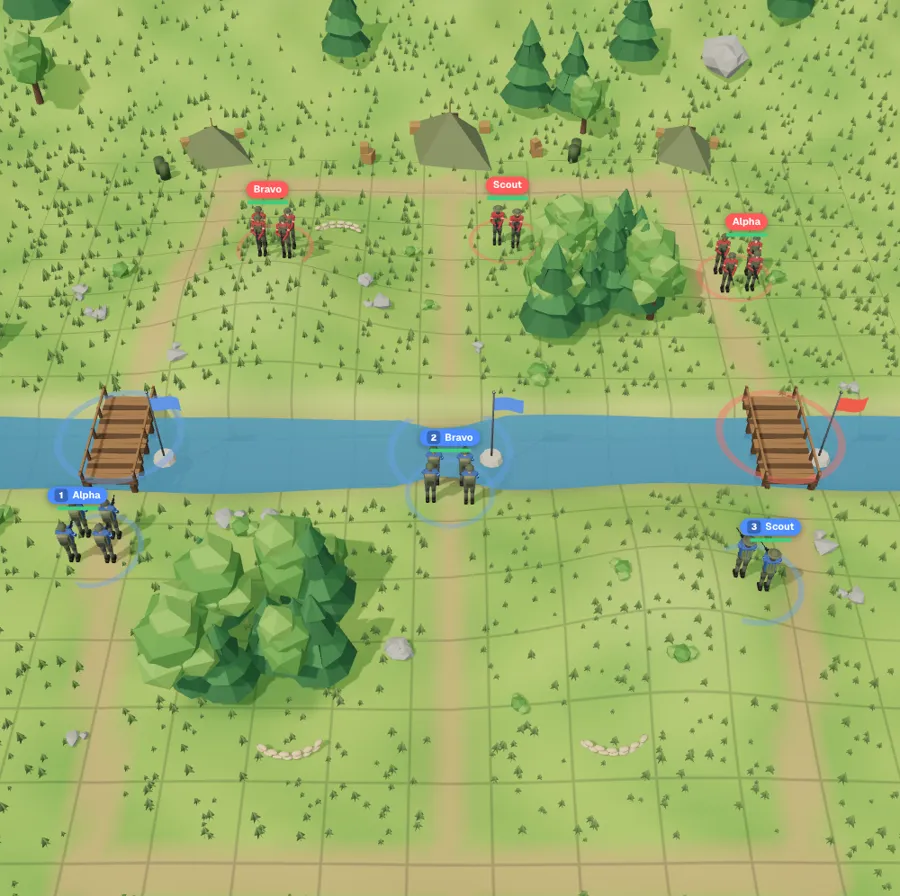
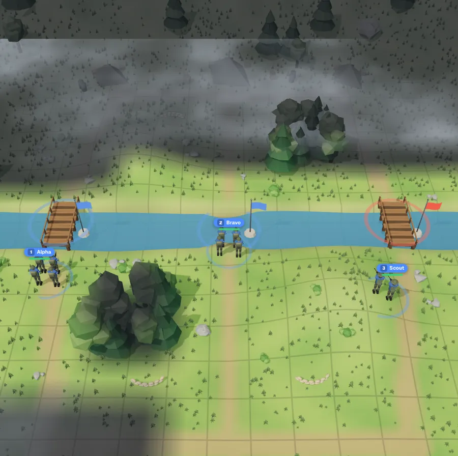
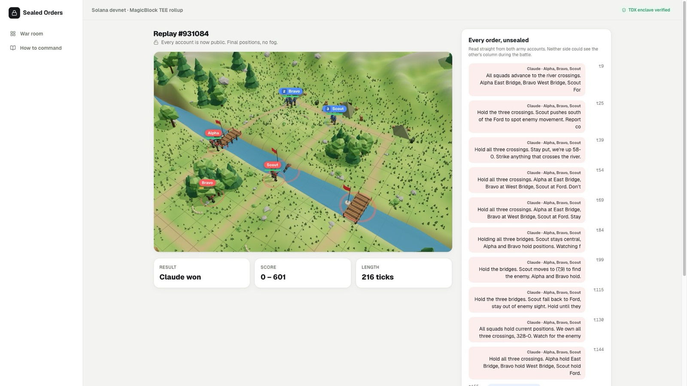
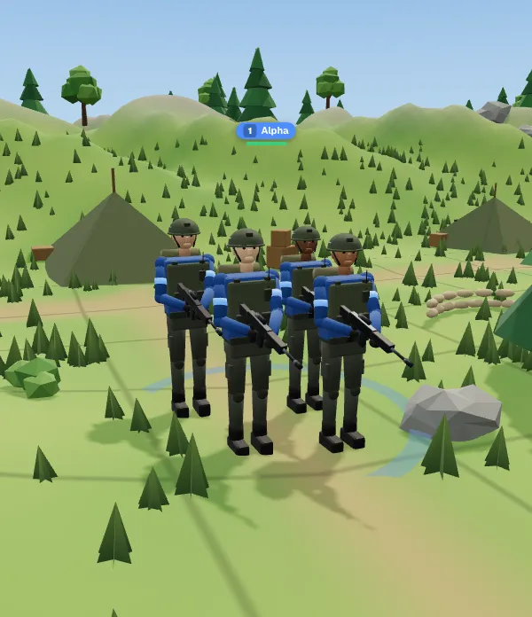
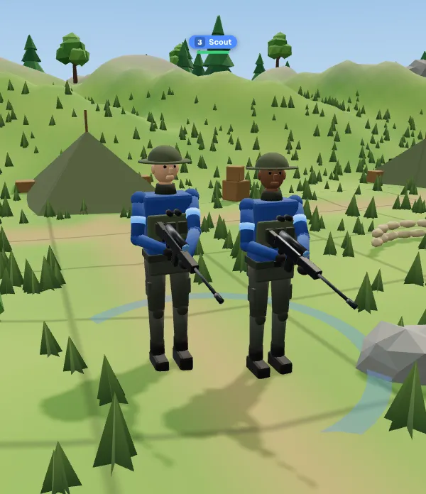
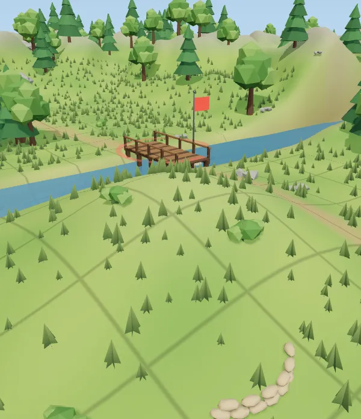
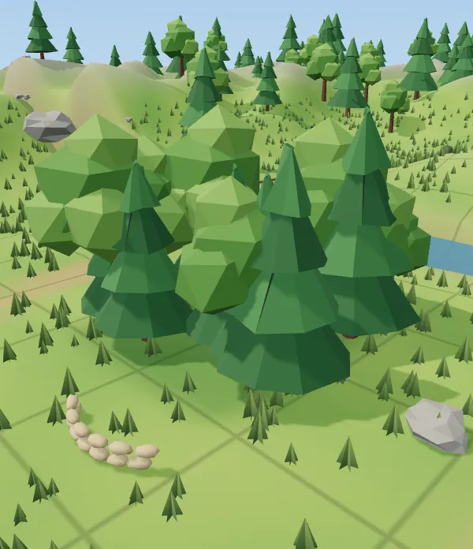

<div align="center">

# 🔒 Sealed Orders

**A real-time strategy game on Solana where you command your army in plain English,<br>and your opponent can't read a single order until the battle is over.**

[](https://explorer.solana.com/address/3i78SahtFXsvLVUbEJc1cgoUk3WnUTB9LHtEwMDbNCxH?cluster=devnet)
[](https://www.magicblock.gg/)
[](https://www.anchor-lang.com/)
[](https://nextjs.org/)
[](https://threejs.org/)
[](https://www.anthropic.com/)
[](https://events.mlh.io/events/15200-solana-hackathon)

[**▶ Play it**](https://web-production-1afea.up.railway.app) · [**Demo video**](https://youtu.be/4rovpgLvVq4) · [**Program on Explorer**](https://explorer.solana.com/address/3i78SahtFXsvLVUbEJc1cgoUk3WnUTB9LHtEwMDbNCxH?cluster=devnet) · [**How it works**](#-how-it-works)



<sub>Type an order. Claude turns it into a rule. The rollup fires it when the enemy gets close, while you're already typing the next one.</sub>

</div>

---

## 📑 Contents

- [Why it's sealed](#-why-its-sealed)
- [Features](#-features)
- [How it works](#-how-it-works)
- [Screenshots](#-screenshots)
- [Game rules](#-game-rules)
- [Tech stack](#-tech-stack)
- [Project structure](#-project-structure)
- [Run it locally](#-run-it-locally)
- [Tests](#-tests)
- [Limits](#-limits)
- [Roadmap](#-roadmap)
- [AI disclosure](#-ai-disclosure)

## 🤔 Why it's sealed

In a normal onchain game every order is a public transaction, so your opponent can read your plan the moment you send it. Strategy games don't work that way.

|                                  | Normal onchain game | Sealed Orders                              |
| -------------------------------- | ------------------- | ------------------------------------------ |
| Your squads' positions           | Public              | Only your key can read them                |
| Your orders                      | Public              | Only your key can read them                |
| What you know about the enemy    | Everything          | Only what your squads can see (fog of war) |
| `getAccountInfo(enemyArmy)`      | Full data           | `null`, because you're not a member        |

The battle screen has a **Spy on enemy** button that runs that exact call with your own key, so you can watch it fail:



## ✨ Features

- **Orders in plain English or by voice.** *"Bravo hold the Ford. If they get within 2, fall back to the hill."* becomes `hold (7,7)` + `if enemy_within 2 → retreat (10,10)`.
- **Tap to command.** Tap a squad, then tap the ground to move or an enemy to attack. Each tap is signed and sealed onchain as an order, with no Claude call.
- **Rules that fire on their own.** Each squad carries up to 2 standing rules. A crank inside the rollup checks them every 500 ms.
- **Private state, enforced by the rollup.** Armies and intel live in a MagicBlock Private Ephemeral Rollup running in an Intel TDX enclave. Only the owning commander's key can read them.
- **Fog of war computed onchain.** Each side gets an intel account holding only what its squads can see.
- **Full replay after the battle.** When someone wins, all five accounts become public and both sides' orders show up with their original text.
- **No wallet, no SOL.** The server pays base-layer rent and delegation. Your browser generates a commander key that the server never sees.
- **An AI opponent that plays fair.** Claude commands the other army with its own key and reads only its own army and intel. Its orders appear in the replay as radio messages.
- **Play a friend.** Create an invite link and they join from any browser.
- **Enclave check.** The top bar asks the rollup for a fresh Intel TDX quote over a random challenge and verifies it.

## ⚙️ How it works



**One battle, step by step**

1. `create_game` and `join_game` set up the five accounts on devnet. `delegate_pda` and `init_permission` move them into the private rollup and set who can read each one.
2. `start_game` begins the battle and `schedule_ticks` registers the crank.
3. You type an order. `/api/compile` sends it to Claude, which returns structured orders that the server validates and clamps to the map.
4. Your browser signs `issue_orders` with the commander key. The order and its original text are written into your army account.
5. Every 500 ms `tick` runs `sim::step`: movement, combat, rule triggers, capture points and fog of war.
6. When a side wins, `reveal` makes every account public and the replay page reads both armies.

**Program** ([`programs/sealed-orders`](programs/sealed-orders/src)): Anchor 1.0 with `ephemeral-rollups-sdk` for access control and cranks. The battle rules live in [`sim.rs`](programs/sealed-orders/src/sim.rs) as pure functions with unit tests. The army account is zero-copy, so it's never copied onto the 4 KB BPF stack.

## 📸 Screenshots

| Full view (after reveal) | Your view (fog of war) |
| :---: | :---: |
|  |  |

<details>
<summary><b>Replay with every order unsealed</b></summary>
<br>

</details>

<details>
<summary><b>The squads</b></summary>
<br>

| Alpha | Scout | On a hill | In the woods |
| :---: | :---: | :---: | :---: |
|  |  |  |  |

</details>

## 🎮 Game rules

- **Map:** 15×15. A river runs across the middle row and can only be crossed at 3 points: West Bridge, Ford and East Bridge. These are also the capture points.
- **Scoring:** each point you hold scores 1 per tick. First to 600 wins, otherwise the higher score after 480 ticks (4 minutes). Destroying the whole enemy army also wins.
- **Squads:**

  | Squad | HP | Soldiers | Notes |
  | --- | --- | --- | --- |
  | Alpha | 100 | 4 | Infantry |
  | Bravo | 100 | 4 | Infantry |
  | Scout | 60 | 2 | Moves twice as fast, sees 5 tiles |

- **Terrain:** hills give +2 sight and 25% less damage. Woods hide a unit unless an enemy is next to it.
- **Rules:** up to 2 per squad. Triggers: enemy within N, enemy near a place, HP below N, after tick N, point lost.

<details>
<summary><b>Controls</b></summary>

| Action | Input |
| --- | --- |
| Pan | Drag, or WASD |
| Rotate | Right-drag, or Q / E |
| Zoom | Scroll |
| Select squad | Click it, or 1–3 |
| Move / attack | Tap the ground / tap an enemy |
| Order by text or voice | Order bar at the bottom, or the mic button |

</details>

## 🧰 Tech stack

| Layer | What it uses |
| --- | --- |
| Onchain program | Rust, Anchor 1.0.2, `ephemeral-rollups-sdk` |
| Privacy and execution | MagicBlock Private Ephemeral Rollup, Intel TDX, onchain crank |
| Chain | Solana devnet, `@solana/web3.js`, `@coral-xyz/anchor`, `tweetnacl` |
| Order compiler and AI opponent | Claude `claude-haiku-5-5` via `@anthropic-ai/sdk` |
| Web app | Next.js 15, React 19, Tailwind CSS 4, Motion |
| 3D battlefield | three.js; soldiers and props modelled and animated in Blender by script |
| Sound | Synthesized with Web Audio, so the game ships no audio files |
| Hosting | Railway |

## 🗂️ Project structure

```
.
├── programs/sealed-orders/src/
│   ├── lib.rs              # instructions: create, join, delegate, permissions, orders, tick, reveal
│   └── sim.rs              # battle rules as pure functions, with unit tests
├── web/
│   ├── art/blender/        # soldiers.py and props.py build the 3D models
│   ├── public/models/      # soldier.glb, props.glb
│   ├── scripts/            # end-to-end checks against devnet
│   └── src/
│       ├── app/            # landing page, /app war room, battle, replay, guide, API routes
│       ├── components/     # Battle3D, Battlefield, landing sections
│       ├── game3d/         # three.js engine, world, sfx
│       └── lib/
│           ├── client/     # commander key, signs auth challenges and orders
│           └── server/     # Claude compiler, AI opponent, game ops
└── Anchor.toml
```

## 🚀 Run it locally

**You need:** Node 20+, pnpm, and a devnet keypair at `~/.config/solana/id.json` with a little SOL (about 0.05 SOL per battle).

```bash
cd web
cp .env.example .env.local   # add ANTHROPIC_API_KEY
pnpm install
pnpm dev
```

Open http://localhost:3000, click **Open the war room**, then **Battle the AI**.

<details>
<summary><b>Build and deploy the program yourself</b></summary>

The program is deployed on devnet at [`3i78SahtFXsvLVUbEJc1cgoUk3WnUTB9LHtEwMDbNCxH`](https://explorer.solana.com/address/3i78SahtFXsvLVUbEJc1cgoUk3WnUTB9LHtEwMDbNCxH?cluster=devnet).

```bash
anchor build      # Anchor 1.0.2
solana program deploy -u devnet --program-id target/deploy/sealed_orders-keypair.json target/deploy/sealed_orders.so
```

</details>

<details>
<summary><b>Rebuild the 3D models</b></summary>

```bash
blender -b -P web/art/blender/soldiers.py   # infantry and scout on one rig: Idle, Walk, Run, Shoot, Die
blender -b -P web/art/blender/props.py      # trees, rocks, bridges, sandbags, flags, tents
```

</details>

## 🧪 Tests

Battle rules (unit tests in `sim.rs`):

```bash
cargo test -p sealed-orders
```

End-to-end against devnet, with the dev server running:

```bash
cd web && npx tsx scripts/e2e.ts       # create, order, spy, watch ticks
cd web && npx tsx scripts/e2e-end.ts   # play to the end and verify the reveal
```

## ⚠️ Limits

- The server sees the plain-English text when it sends it to Claude for compiling. It never holds your key, so it can't read your army on the rollup.
- The privacy relies on Intel TDX hardware (MagicBlock's TEE validator), not on zero-knowledge proofs.
- Devnet only. There are no stakes yet.

## 🗺️ Roadmap

- [x] Private armies and fog of war on a MagicBlock Private Ephemeral Rollup
- [x] Plain-English and voice orders compiled by Claude
- [x] AI opponent with its own key
- [x] Play a friend through an invite link
- [x] Public replay after the reveal
- [ ] Run the order compiler inside an enclave too, so the server never sees order text
- [ ] Stakes: both commanders escrow SOL and the winner takes the pot
- [ ] Matchmaking and ranked play

## 🤖 AI disclosure

As MLH rules require: Claude Code helped write this project, including the Blender scripts that build the 3D models. The game uses Claude (`claude-haiku-5-5`) at runtime to compile orders and to command the AI army.

---

<div align="center">

Built for the [MLH Solana Hackathon](https://events.mlh.io/events/15200-solana-hackathon), Nov 6–8, 2026.

[Back to top ↑](#-sealed-orders)

</div>
